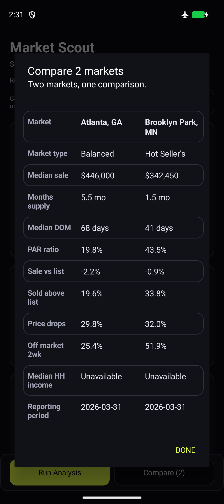

# Android Client

## Purpose

The Android app is a native companion client for Market Scout. It provides the core mobile
workflow: add a city, ZIP code, or county; paste a bulk list; run a market scan; filter and
sort results; compare two or three markets; export a CSV; and open Zillow or Redfin for
deeper research. Named lists, favorites, and market notes preserve research between sessions.



## Separation Boundary

The Android client is a standalone Gradle project under `android/`. It does not import the
Python application or the web UI. The web clients and Android client share one stable boundary:
the generated static data published at:

```text
https://market-scout-anl.pages.dev/data/manifest.json
https://market-scout-anl.pages.dev/data/search-index.json
https://market-scout-anl.pages.dev/data/markets/<type>/<state>.json
```

This keeps deployments independent. A web UI change does not require an Android release, and
an Android UI release does not require changing the data build or Flask runtime.

## Runtime Flow

1. `ResearchStore` restores the shortlist, results, drafts, sort/filter settings, favorites,
   and notes from private device storage. `MainActivity` renders saved work immediately.
2. `MarketDataRepository` loads a cached manifest/index first and refreshes it in the background.
3. `MarketSearchIndex` resolves exact or bulk-pasted city, ZIP, and county names locally.
4. `ScanSession` takes a frozen shortlist and gives the scan a generation token. Canceling,
   clearing, or switching lists invalidates earlier callbacks and cancels network requests.
5. `MarketDataRepository` loads only the required state/type shard. `SnapshotCache` writes
   atomically, caps the cache at 32 MiB, and rejects fallback data from a different snapshot.
6. The app maps each JSON record into a typed `MarketResult` and optionally enriches it with
   Census ACS household-income data.
7. Compact cards show pricing, supply, median DOM, and PAR. Additional metrics and research
   actions expand on demand. Two or three selected markets can be compared side by side.
8. Android's document picker exports the currently filtered/sorted results, including notes
   and favorites, as an actual CSV file without broad storage permission.

Network failures are shown per market instead of crashing the scan. The app remains useful
without a login because the published data is public and the Census enrichment is optional.

## Build And Install

Requirements:

- Android SDK with the API 36 platform, build-tools, and platform-tools
- JDK 17

From the repository root:

```bash
cd android
./gradlew assembleDebug
./gradlew installDebug
```

The debug APK is written to `android/app/build/outputs/apk/debug/app-debug.apk`.

## Verification And CI

```bash
./gradlew testDebugUnitTest lintDebug assembleDebug
./gradlew connectedDebugAndroidTest
```

The first command runs fixture-based JVM tests for bulk parsing, numeric sorting,
geography matching, saved research, filters, scan cancellation, and snapshot caching.
The second requires a connected emulator/device and tests real private storage, activity
recreation, draft persistence, cached data, and accessible touch targets.

`.github/workflows/android.yml` runs these checks on pushes and pull requests, including
an API 35 emulator job, and uploads the debug APK plus test/lint reports. Debug APKs are
available under the successful GitHub Actions run's **Artifacts** section.

## Research And Privacy

- Named lists save selected markets plus sort and filter settings. Opening one cancels any
  active scan and clears the previous comparison so results cannot be assigned to the wrong list.
- Favorites and notes are keyed by market identity and shared across lists on the device.
- Drafts and results survive activity recreation and process restarts. Interrupted scans
  retain completed results and require an explicit retry; they do not restart silently.
- App data is private to the Android application. Automatic Android backup is disabled.
  The app sends no lists or notes to a server and provides no cross-device synchronization.
- Exports contain the user's notes; the user chooses where the CSV is saved.

## Constraints

- The app depends on the availability of the public Cloudflare Pages data artifacts.
- Redfin freshness is inherited from the latest generated source snapshot; it is displayed in
  the app rather than fetched live for every search.
- Household income comes from the Census ACS 5-year API and may be unavailable for some small
  geographies or during an API outage.
- ZIP-code markets are smaller geographic areas, so metrics such as months of supply and price
  drops can be sparse or less stable than city- or county-level data.
- Offline lookup requires a previously downloaded search index and relevant market shard.
  Saved research remains available even without the search index. Cached readings are labeled.
- Income enrichment still uses the 2022 ACS 5-year dataset. It is optional and cached; the
  UI labels it as a median estimate. It is not a current income measurement.
- The interface currently uses English copy. Large-text and TalkBack behavior should be
  checked on physical devices before a public store release.

## Release Boundary

The `android-client` branch is reviewed before merging into `master`. Android versions are
set independently in `android/app/build.gradle.kts`; this update is version `1.1.0` (code `2`).

Local release builds use these four environment variables:

- `MARKET_SCOUT_KEYSTORE`: absolute path to the owner's upload keystore
- `MARKET_SCOUT_STORE_PASSWORD`
- `MARKET_SCOUT_KEY_ALIAS`
- `MARKET_SCOUT_KEY_PASSWORD`

```bash
./gradlew lintRelease assembleRelease bundleRelease
```

With all four variables present, Gradle signs the APK and App Bundle. With none provided,
local release output is unsigned. A partial signing configuration fails explicitly.
Keystores are ignored by Git and must be backed up securely by the owner.

The manual `.github/workflows/android-release.yml` workflow requires GitHub secrets
`ANDROID_KEYSTORE_BASE64`, `ANDROID_STORE_PASSWORD`, `ANDROID_KEY_ALIAS`, and
`ANDROID_KEY_PASSWORD`. It runs checks, verifies the APK signature, uploads the signed APK
and AAB as artifacts, and removes the temporary private key. It does not publish to Google Play.
The owner's signing key and store account are required for actual distribution.
